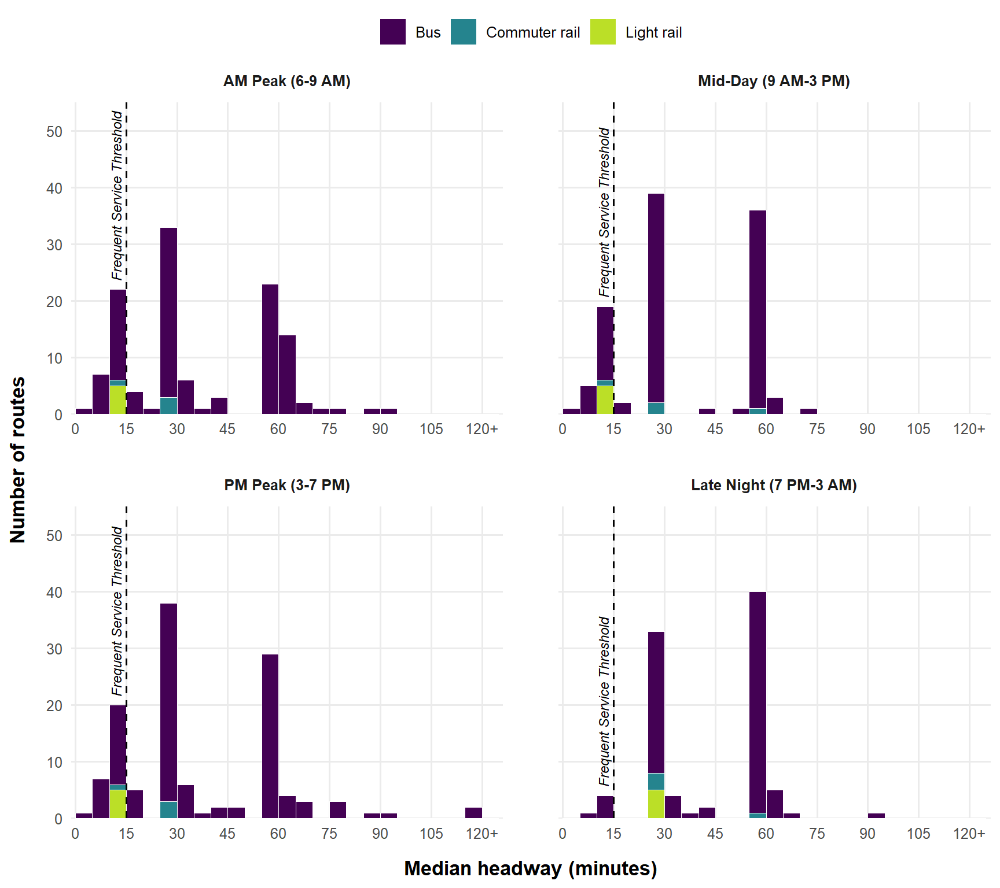

# How much of Denver can walk to frequent transit?

**[Read the full write-up →](https://austinthomas7.github.io/rtd-frequent-network/)**

A SQL and R analysis of how RTD's weekday service changes from the morning peak to late night. It uses the public GTFS feed, the OpenStreetMap walking network, and Census ACS data, and measures access along real streets rather than straight-line buffers.

## Key findings

Results are for a typical weekday, Wednesday, September 30, 2026. A route or stop counts as **frequent** when its median scheduled gap is 15 minutes or less.

- **Frequent service is a daytime network.** 29 of RTD's 128 routes are frequent in the AM peak, 25 at mid-day, and 28 in the PM peak. After 7 PM only **5** remain: the 16th Street FreeRide, Broadway (0 and SKIP), East Colfax (15), and Federal (31). No rail line stays frequent at night.
- **Most of the system runs every 30 minutes or worse.** The typical route comes every 30 minutes during the day and roughly once an hour (56 minutes) late at night.
- **Frequent stops fall by about 80% after dark.** About 22% of stops have a frequent route in the AM peak (1,667 of 7,453), compared with 4.8% late at night (361).
- **About 1 in 8 residents can walk to frequent service at rush hour.** 13.2% of the 3.2 million people in the seven-county RTD area live within a quarter-mile walk of a frequent stop in the AM peak. Late at night that falls to **4.1%**.
- **Households without a car are better served, but still lose half their access at night.** 33% of car-free households are within a frequent walkshed in the AM peak, more than twice the rate for all households (15%). After 7 PM that falls to 15.5%.
- **Straight-line buffers overstate access.** Simple quarter-mile circles would count 16.4% of residents near frequent AM service. The street-network walksheds count 13.2%, because freeways, rail lines, and cul-de-sacs lengthen the real walk.

| Period | Frequent routes | Frequent stops | Residents within a ¼-mile walk | Car-free households within a ¼-mile walk |
|---|--:|--:|--:|--:|
| AM Peak (6–9 AM) | 29 | 22.4% | 13.2% | 33.1% |
| Mid-Day (9 AM–3 PM) | 25 | 19.5% | 11.8% | 31.3% |
| PM Peak (3–7 PM) | 28 | 23.1% | 13.1% | 32.9% |
| Late Night (7 PM–3 AM) | 5 | 4.8% | 4.1% | 15.5% |



## Questions

1. How often does each RTD route run in the AM Peak (6–9 AM), Mid-Day (9 AM–3 PM), PM Peak (3–7 PM), and Late Night (7 PM–3 AM)?
2. Which stops get frequent service (a median gap of 15 minutes or less between buses) in each period?
3. Who lives within a quarter-mile walk of that service, especially people without a car, and how does that change for people who travel outside the peaks?
4. Why do scheduled headways vary within a period, and when do they stray from round numbers like 10 or 15?

## Data

| Source | Use |
|---|---|
| [RTD GTFS](https://www.rtd-denver.com/open-records/open-spatial-information/gtfs) (downloaded October 6, 2026) | Routes, stops, trips, and scheduled departure times |
| ACS 5-year 2019–2023, tables B01003 and B25044 | Population and zero-vehicle households by block group |
| [OpenStreetMap](https://www.openstreetmap.org/copyright) (Geofabrik Colorado extract) | Streets, sidewalks, and paths for network walk distances |

## Skills demonstrated

- **SQL (DuckDB):** CTEs, `LAG()` and `row_number()` window functions, `QUALIFY`, medians and percentiles (`median`, `quantile_cont`), window partitions by time period, `FILTER` aggregates, calendar expansion with `generate_series`, set operations (`UNION` / `EXCEPT`), type casting and cleaning
- **R:** OpenStreetMap network analysis (`osmextract`, `igraph` shortest paths), `sf` areal interpolation, `tidycensus`, `ggplot2`, `leaflet`
- **Reproducible reporting:** Quarto website published with GitHub Pages

## Project structure

```
sql/                      the analysis, in run order
  01_clean_tables.sql       cast raw text to typed tables, times to seconds
  02_pick_service_day.sql   choose a typical Wednesday, define the four periods
  03_route_headways.sql     min / max / median headways with LAG(), gaps inside each period only
  04_stop_frequency.sql     flag frequent stops in each period
  05_headline_metrics.sql   one row of key numbers per period
  06_headway_diagnostics.sql  classify every gap between trips (why headways vary)
R/
  00_setup.R                install packages (run once)
  config.R                  shared settings and helper
  01_download_gtfs.R ... 03_run_sql.R
  04_osm_network.R          OpenStreetMap walking network
  05_walksheds.R            quarter-mile network walksheds by period
  06_census_access.R        who lives inside each walkshed
run_all.R                 rebuild everything
index.qmd                 the write-up (renders to docs/)
additional-data.qmd       supporting tables: min/median/max headway by route and period
output/                   CSV results
```

## Reproduce

1. Get a free [Census API key](https://api.census.gov/data/key_signup.html) and follow `R/00_setup.R`. It is the only key the project needs.
2. Run `run_all.R` from the project root. The first run downloads about 300 MB of OpenStreetMap data into `data/osm/`.
3. In a terminal: `quarto render`

Because RTD updates its GTFS feed several times a year, a fresh run may pick a different service day and produce slightly different numbers.

## Author

Austin Foster · [LinkedIn](https://www.linkedin.com/in/austin-foster-4a6506159/)
